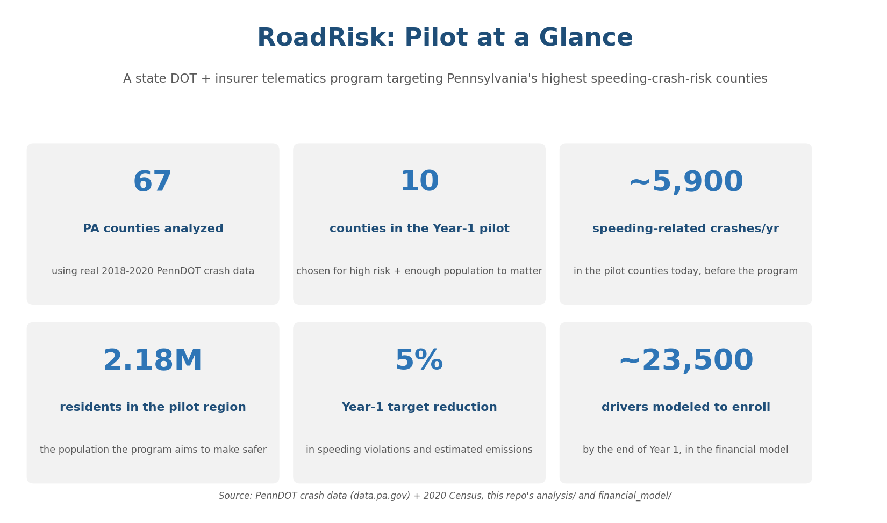
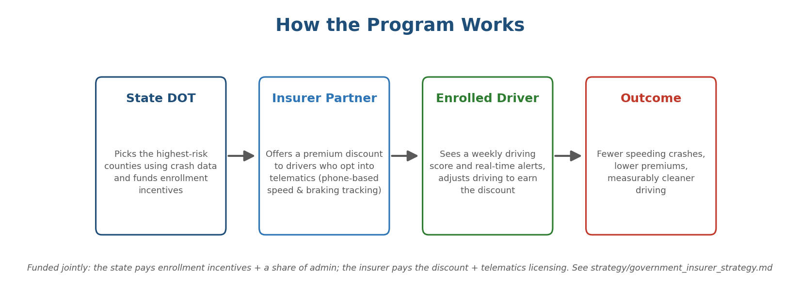
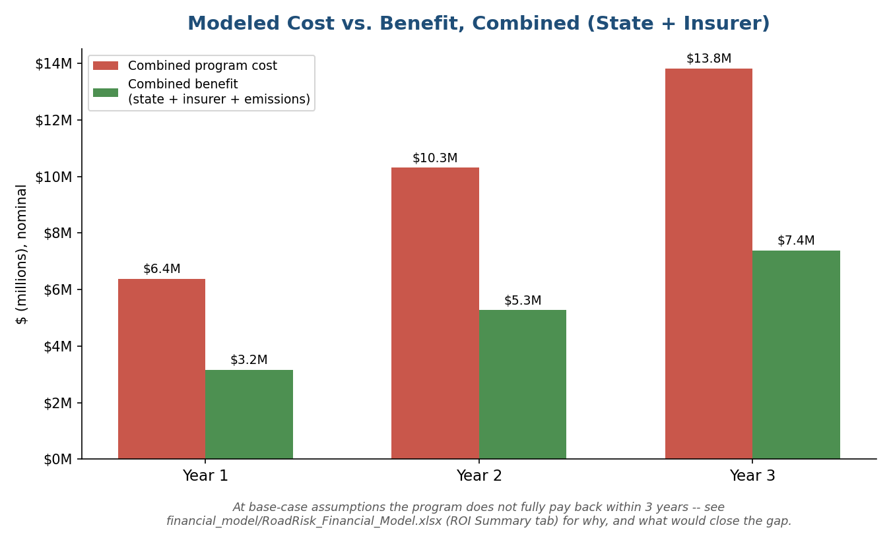

# RoadRisk


A regional traffic-safety analysis and program design case study: identify the counties where speeding-related crashes are most concentrated, then design a state DOT–insurer telematics program to bring that down, with the market research and financial model to back it.

**In plain English:** some Pennsylvania counties have far more speeding-related car crashes per person than others. This project uses real government crash records to figure out exactly which ones, then designs a program where the state and a car insurance company team up to offer safer drivers a discount for using a phone app that tracks their driving — the goal being fewer risky crashes and somewhat cleaner driving. It also includes a spreadsheet estimating what running that program would actually cost and save over three years. New to a term like "telematics" or "KPI"? See the [glossary](GLOSSARY.md). Common questions are answered in the [FAQ](FAQ.md).

**The chain, end to end:** [real county crash data](data/) → [risk ranking](analysis/) → [program strategy](strategy/) → [financial model](financial_model/). Every number in the strategy and financial model traces back to the data in this repo — nothing here is a placeholder.



## How the program works

Non-technical summary of the mechanism the rest of this repo builds the case for:



## What's in this repo

| Folder | What it is |
|---|---|
| [`data/`](data/) | Real PennDOT crash data (2018–2020, via the [data.pa.gov](https://data.pa.gov) public API) and 2020 Census county population, plus the processed county risk ranking. See [`data/SOURCES.md`](data/SOURCES.md) for full provenance and caveats. |
| [`analysis/`](analysis/) | [`county_risk_analysis.py`](analysis/county_risk_analysis.py) — loads the raw data, computes speeding-related and fatal crash rates per 100,000 residents by county, builds a composite risk score, and produces the ranking and charts below. |
| [`strategy/`](strategy/) | [`market_research_brief.md`](strategy/market_research_brief.md) — the competitive/market case for a telematics safe-driving program. [`government_insurer_strategy.md`](strategy/government_insurer_strategy.md) — the program design, target counties, Year-1 KPIs, and financial mechanism. |
| [`financial_model/`](financial_model/) | [`RoadRisk_Financial_Model.xlsx`](financial_model/RoadRisk_Financial_Model.xlsx) — a 3-year cost/benefit model plus a live Year-1 KPI tracker (target vs. actual). [`build_model.py`](financial_model/build_model.py) rebuilds it from scratch if the assumptions change. |
| [`tests/`](tests/) | Unit tests validating the risk-ranking pipeline (correct county count, no negative rates, top-risk counties match what's checked in) — run automatically on every push via [GitHub Actions](.github/workflows/tests.yml). |

## Key finding

Pennsylvania's highest per-capita speeding-related crash rates are concentrated in a small set of counties — several rural counties run **5–8x the statewide rate**, while a distinct set of mid-size counties combine elevated risk with a large enough population to make an insurer partnership commercially viable. That split (see the two pilot shortlists in [`data/processed/`](data/processed/)) is the basis for the program's phased rollout in the strategy doc.

<p>
  
  
</p>

## Does the program pay for itself?

Not within 3 years, at conservative assumptions — and the model says so plainly rather than hiding it:



The `ROI Summary` and `Sensitivity` tabs in the [financial model](financial_model/RoadRisk_Financial_Model.xlsx) walk through exactly why (a flat premium discount paid to the whole enrolled book vs. a benefit that only accrues where behavior actually changes) and what would close the gap (a score-tiered discount, a longer multi-cohort horizon, or counting the state's non-monetized public value).

## Reproducing everything

```bash
python3 -m pip install -r requirements.txt

python3 analysis/county_risk_analysis.py   # data/processed/county_risk_scores.csv + 2 analytical charts
python3 analysis/build_visuals.py          # the 3 non-technical visuals above
cd financial_model && python3 build_model.py && cd ..   # rebuilds the Excel model from scratch
python3 -m pytest tests/ -v                # validates the analysis pipeline (see tests/)
```

`build_model.py` writes the workbook's `Assumptions` cells from the constants at the top of the script — edit those (or the blue input cells directly in the workbook) and every dependent formula recalculates on open in Excel, Google Sheets, or LibreOffice.

## Engineering notes

- **Reproducible pipeline, not a one-off notebook:** every derived file (`data/processed/*.csv`, every PNG, the `.xlsx`) is generated by a checked-in script from the raw data also checked into the repo — nothing here was hand-edited after the fact.
- **The Excel model uses live formulas, not hardcoded numbers.** `build_model.py` writes `=` formulas referencing labeled, commented assumption cells, so changing one input recalculates the whole 8-tab workbook — see `financial_model/build_model.py`.
- **Tested and CI'd:** `tests/` checks the risk-ranking logic (county count, no negative/NaN rates, expected top-risk counties) and runs on every push via GitHub Actions (badge at the top of this file). Public repos get free CI minutes, so this costs nothing to keep running.
- **Stack:** Python (pandas, matplotlib, openpyxl), pytest, GitHub Actions. No paid APIs or services anywhere in the pipeline — everything reads from static files already in this repo.
- **Dependencies pinned to exact versions**, with [Dependabot](.github/dependabot.yml) opening weekly PRs for updates rather than silently floating to whatever's newest. See [`SECURITY.md`](SECURITY.md) for the full security posture.

## Honest limitations

- The crash data is real but the *program* is a design exercise, not a deployed pilot — the strategy and financial model are written to be handed to a real state DOT / insurer partnership, not a report of one that already exists.
- The financial model does not shy away from an unflattering result: at conservative assumptions, the insurer's discount cost is not fully offset by claims savings within 3 years, and hitting the 5% population-level KPI with a single insurer partner requires either higher enrollment/effect than a Year-1 pilot can realistically deliver or a multi-carrier consortium. Both findings — and what would change them — are documented on the `ROI Summary` and `Sensitivity` tabs of the financial model.
- See [`data/SOURCES.md`](data/SOURCES.md) for what the underlying crash data does and doesn't capture (officer-coded speeding flags, not telematics-derived; most recent complete year is 2020 in the public dataset).

## More docs

- [`GLOSSARY.md`](GLOSSARY.md) — plain-English definitions of the industry terms used throughout (telematics, UBI, KPI, loss ratio, etc.).
- [`FAQ.md`](FAQ.md) — answers to the questions a reviewer usually has (is this real, who is it for, why does the ROI look negative, can I reuse it).
- [`CONTRIBUTING.md`](CONTRIBUTING.md) — how this repo is maintained and how to suggest a change.
- [`SECURITY.md`](SECURITY.md) — this repo's security scope and what's already in place.
