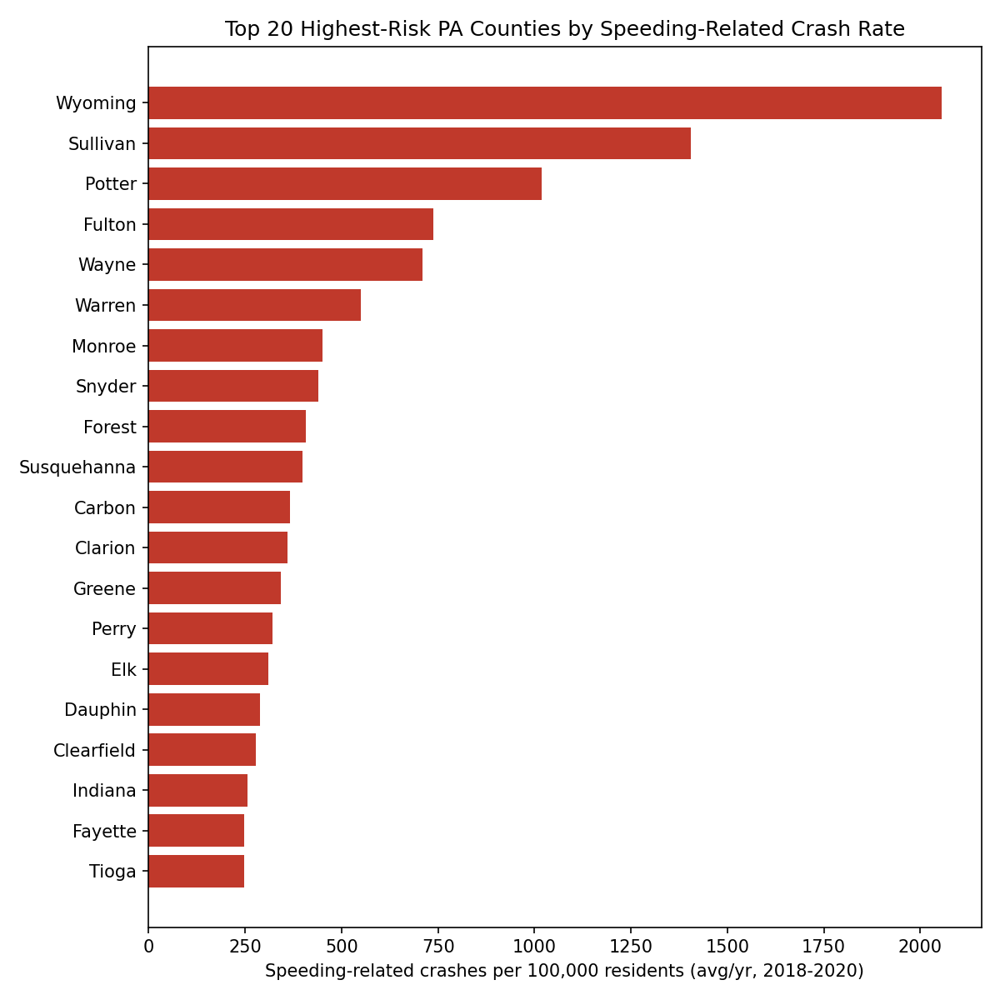
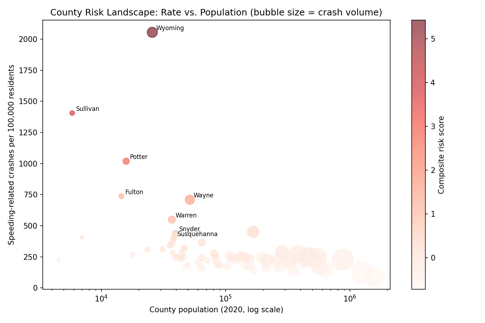

# RoadRisk

A regional traffic-safety analysis and program design case study: identify the counties where speeding-related crashes are most concentrated, then design a state DOT–insurer telematics program to bring that down, with the market research and financial model to back it.

**The chain, end to end:** [real county crash data](data/) → [risk ranking](analysis/) → [program strategy](strategy/) → [financial model](financial_model/). Every number in the strategy and financial model traces back to the data in this repo — nothing here is a placeholder.

## What's in this repo

| Folder | What it is |
|---|---|
| [`data/`](data/) | Real PennDOT crash data (2018–2020, via the [data.pa.gov](https://data.pa.gov) public API) and 2020 Census county population, plus the processed county risk ranking. See [`data/SOURCES.md`](data/SOURCES.md) for full provenance and caveats. |
| [`analysis/`](analysis/) | [`county_risk_analysis.py`](analysis/county_risk_analysis.py) — loads the raw data, computes speeding-related and fatal crash rates per 100,000 residents by county, builds a composite risk score, and produces the ranking and charts below. |
| [`strategy/`](strategy/) | [`market_research_brief.md`](strategy/market_research_brief.md) — the competitive/market case for a telematics safe-driving program. [`government_insurer_strategy.md`](strategy/government_insurer_strategy.md) — the program design, target counties, Year-1 KPIs, and financial mechanism. |
| [`financial_model/`](financial_model/) | [`RoadRisk_Financial_Model.xlsx`](financial_model/RoadRisk_Financial_Model.xlsx) — a 3-year cost/benefit model plus a live Year-1 KPI tracker (target vs. actual). [`build_model.py`](financial_model/build_model.py) rebuilds it from scratch if the assumptions change. |

## Key finding

Pennsylvania's highest per-capita speeding-related crash rates are concentrated in a small set of counties — several rural counties run **5–8x the statewide rate**, while a distinct set of mid-size counties combine elevated risk with a large enough population to make an insurer partnership commercially viable. That split (see the two pilot shortlists in [`data/processed/`](data/processed/)) is the basis for the program's phased rollout in the strategy doc.

<p>
  
  
</p>

## Reproducing the analysis

```bash
python3 -m pip install pandas matplotlib openpyxl
python3 analysis/county_risk_analysis.py
```

Regenerates `data/processed/county_risk_scores.csv` and both figures above from the raw data already checked into this repo.

## Reproducing the financial model

```bash
cd financial_model
python3 build_model.py
```

Rebuilds `RoadRisk_Financial_Model.xlsx` from `Assumptions` cells you can edit directly in the script, or edit the blue input cells in the workbook itself (Excel/Google Sheets/LibreOffice all recalculate the formulas on open).

## Honest limitations

- The crash data is real but the *program* is a design exercise, not a deployed pilot — the strategy and financial model are written to be handed to a real state DOT / insurer partnership, not a report of one that already exists.
- The financial model does not shy away from an unflattering result: at conservative assumptions, the insurer's discount cost is not fully offset by claims savings within 3 years, and hitting the 5% population-level KPI with a single insurer partner requires either higher enrollment/effect than a Year-1 pilot can realistically deliver or a multi-carrier consortium. Both findings — and what would change them — are documented on the `ROI Summary` and `Sensitivity` tabs of the financial model.
- See [`data/SOURCES.md`](data/SOURCES.md) for what the underlying crash data does and doesn't capture (officer-coded speeding flags, not telematics-derived; most recent complete year is 2020 in the public dataset).
